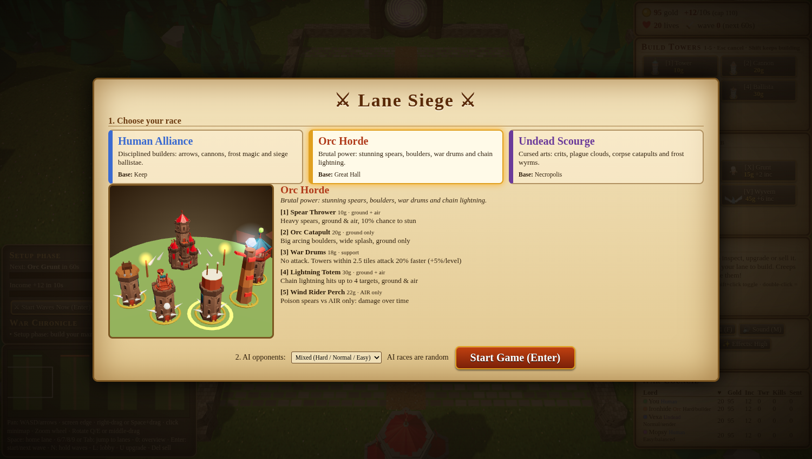
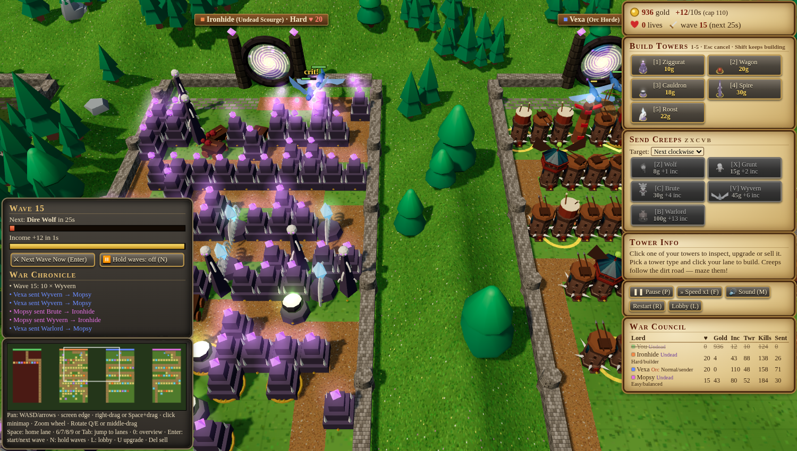
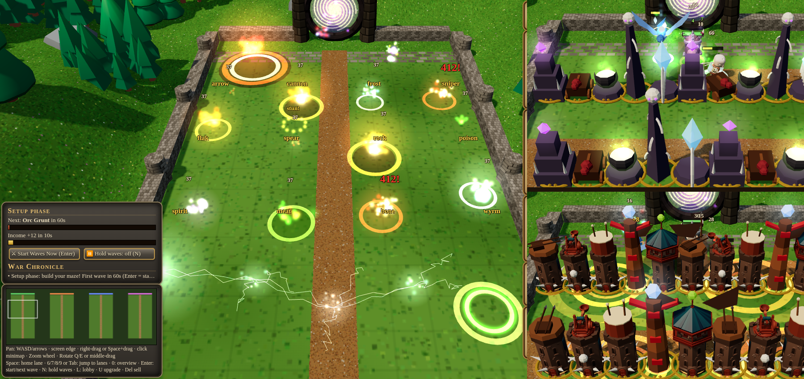

# ⚔ Lane Siege — Line Tower Wars-style 3D Tower Defense

[](https://lane-wars-td.pages.dev)


A browser tower-defense game in 3D, in the spirit of the classic Warcraft III custom map **Line Tower Wars**.
Four lanes, one human and three AI opponents. You build a maze in your lane to defend against creeps, and send creeps
of your own at your rivals to raise your income. The last lord standing wins.

**🎮 Play it now: https://lane-wars-td.pages.dev**. No install needed; it runs in any modern desktop browser.



## Screenshots

| Scouting an opponent's lane | Impact effects for each tower |
|---|---|
|  |  |

## Features

- **Four-lane Line Tower Wars gameplay.** Each lane is pathfound with BFS and you build the maze yourself. A tower that would block the creeps' path completely can't be placed.
- **Economy and sending.** Send creeps (wolf, grunt, brute, wyvern, warlord) at another lane to raise your income every 10 seconds. Income is capped so the leader doesn't snowball.
- **Three races with their own tower sets** (Human, Orc, Undead). Each set covers both ground and air, with mechanics like splash, slow, stun, chain lightning, poison damage over time, crits, an attack-speed aura and a pulsing damage aura.
- **AI opponents.** They have personalities (builder, sender, balanced) and Easy/Normal/Hard difficulty, play random races, maze, upgrade and pick their sends.
- **Setup phase.** You get 60 seconds to build before the first wave. You can start waves early (Enter) or hold the wave timer between waves (N).
- **Free camera over all 4 lanes.** Pan, zoom and rotate, click the minimap to jump, and use hotkeys for each lane. The lane under the camera always renders at full detail, so you can watch the AIs build and fight.
- **Multi-select towers.** Box-select, Shift-click and double-click to select; upgrade all (cheapest first) or sell all.
- **Hit effects and sounds for each tower.** Stuck arrows, fiery explosions with scorch marks, ice crystals, branching lightning, poison bubbles, soul wisps, gore splats and more. Each creep type has its own death effect, and there are optional floating damage numbers.
- **Built to stay fast.** It uses instancing, pooled particles and effects, skeleton stand-ins for far lanes and a shadow camera that follows the view. An **Effects: High/Low** toggle cuts the effect load further.
- **Procedural sound.** All sound is synthesised with the Web Audio API, so there are no audio files.
- **Works offline.** Three.js and the 3D models are bundled locally, so `index.html` also works opened straight from disk (`file://`).

## Races & towers

#### Human Alliance — castle: Keep

| Key | Tower | Cost | Targets | Effect |
|---|---|---|---|---|
| 1 | Archer Tower | 10g | ground + air | Fast arrows, hits ground & air |
| 2 | Dwarven Cannon | 20g | ground | Arcing splash, ground only |
| 3 | Frost Mage Tower | 18g | ground + air | Chills (50% slow), ground & air |
| 4 | Ballista | 30g | ground | Huge range & damage, ground only |
| 5 | Gryphon Fire Brazier | 22g | air | Fireballs vs AIR only, splash |

#### Orc Horde — castle: Great Hall

| Key | Tower | Cost | Targets | Effect |
|---|---|---|---|---|
| 1 | Spear Thrower | 10g | ground + air | Heavy spears, ground & air, 10% chance to stun |
| 2 | Orc Catapult | 20g | ground | Big arcing boulders, wide splash, ground only |
| 3 | War Drums | 18g | support | No attack. Towers within 2.5 tiles attack 20% faster (+5%/level) |
| 4 | Lightning Totem | 30g | ground + air | Chain lightning hits up to 4 targets, ground & air |
| 5 | Wind Rider Perch | 22g | air | Poison spears vs AIR only: damage over time |

#### Undead Scourge — castle: Necropolis

| Key | Tower | Cost | Targets | Effect |
|---|---|---|---|---|
| 1 | Spirit Ziggurat | 10g | ground + air | Spirit bolts, ground & air, 20% chance of x3 crit |
| 2 | Meat Wagon | 20g | ground | Arcing corpses: splash + plague DoT, ground only |
| 3 | Plague Cauldron | 18g | ground | Poison cloud: damages & slows ALL ground creeps in range |
| 4 | Bone Spire | 30g | ground | Long-range bone lance, ground only, 25% crit |
| 5 | Frost Wyrm Roost | 22g | air | Freezing breath vs AIR only: splash + slow |

Tower costs are the same for each slot across races, which keeps the races balanced and lets the AI logic work for all of them. Towers upgrade up to **level 4**.

## Controls

| Action | Input |
|---|---|
| Build tower | `1`–`5` then click your lane (`Shift` keeps building) |
| Send creeps | `Z` `X` `C` `V` `B` (pick a target lane in the panel) |
| Select / multi-select | Click · `Shift`+drag box · `Shift`+click toggle · double-click = all of that type · `Ctrl+A` |
| Upgrade / sell | `U` (all selected, cheapest first) · `Del` / `Backspace` |
| Start waves now / next wave | `Enter` |
| Hold wave timer | `N` |
| Pan camera | `WASD` / arrows · screen edge · right-drag · `Space`+drag · click the minimap |
| Jump to a lane | `6` `7` `8` `9` or `Tab` · `Space` = home · `0` = overview |
| Zoom / rotate | Mouse wheel · `Q`/`E` or middle-drag |
| Pause · speed · mute | `P` · `F` · `M` |
| Restart · lobby | `R` · `L` |

## Tech stack

- **Three.js r160.** WebGL rendering, GLTF models, skinned animation, instanced meshes and a custom point-sprite particle shader.
- **Vanilla JavaScript.** There's no framework and no build step to play. Each layer is a separate script: `logic.js` → `core.js` → `races.js` → `game3d.js`.
- **Web Audio API** for all sound effects, synthesised from oscillators and filtered noise.
- **Playwright** (`playwright-core` driving headless Chrome with SwiftShader) for end-to-end tests: the lobby, every race, a long AI run, multi-select, the camera, impact effects and the JS error log.
- **Cloudflare Pages** for hosting: a static deploy with `wrangler pages deploy`.

## Run locally

```bash
git clone https://github.com/lorplace/lane-wars-td.git
cd lane-wars-td
# Either just open index.html in your browser (works from file://), or serve it:
python3 -m http.server 8000   # then open http://localhost:8000
```

### Tests

```bash
npm install                      # installs playwright-core only
CHROME_PATH=/path/to/chrome node tests/v5.js    # lobby, races, long AI run, camera panning
node tests/ms.js                 # multi-select box/shift/ctrl+A, upgrade all, sell all
node tests/imp.js                # impact effects for every race, effects toggles
node tests/show.js               # staged impact showcase screenshot
```
Screenshots from the tests are written to `tests/out/`.

## Project structure

```
index.html              HUD, lobby, styles and script order
assets/
  three.bundle.js       Three.js r160 + GLTFLoader + SkeletonUtils (IIFE bundle, MIT)
  models.js             KayKit CC0 GLB models embedded as base64 (so file:// works)
  logic.js              core simulation: grid, BFS pathing, waves, creeps, economy, AI, sound
  core.js               stuns, AI tower-upgrade logic
  races.js              races, tower sets & mechanics, setup phase, impact metadata
  game3d.js             renderer, camera, effects, HUD, minimap, lobby, input
tests/                  Playwright end-to-end tests
docs/                   screenshots
CREDITS.txt             asset credits & licenses
```

## Credits

- 3D models: [KayKit](https://kaylousberg.com/) by Kay Lousberg: *Skeletons*, *Medieval Hexagon* and *Adventurers* packs. **CC0 1.0**. Orc and Undead towers and castles are tinted KayKit pieces combined with original geometry built in code.
- Rendering: [Three.js](https://threejs.org/) (MIT).
- All code, game design, effects and sounds are original work.

> **Note:** This is an original fan-made game *inspired by* the Warcraft III custom map *Line Tower Wars*.
> It uses no Blizzard Entertainment assets, code or audio, and is not affiliated with or endorsed by Blizzard.

## License

The code is under the [MIT License](LICENSE). The bundled KayKit models stay under **CC0 1.0**, and Three.js stays under its own MIT license (see `CREDITS.txt`).
